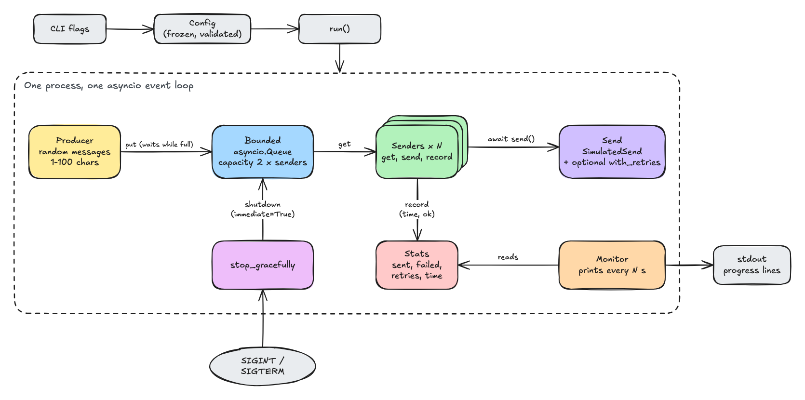
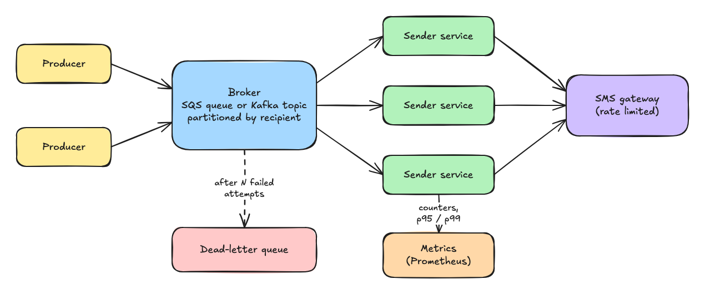

# Architecture

This document explains how the SMS alert simulation is built and the approach, the design, the trade-offs I considered, the constraints, how it would scale, how it handles failure, how it is tested, and what it does not do. To run it, see the [README](README.md). 

## Approach

The work in this system is mostly waiting. A sender hands a message to a gateway and waits for an answer; generating a message and counting the result take microseconds. So I optimised for cheap waiting rather than for computation:

- **One process, one asyncio event loop.** Each sender is a task, not a thread, so thousands of senders cost a few megabytes.
- **Standard library first.** The queue, the task supervision, the timeouts and the signal handling are all `asyncio` primitives. The only dependencies are for testing and for drawing benchmark charts.
- **Every message is accounted for.** Each message ends up exactly once as sent, failed or unsent, whether the run finishes, crashes or is stopped. Most of the design decisions below follow from that rule.
- **Measure, don't assume.** Throughput, memory and the bottleneck are measured and profiled, not estimated.

## Architecture diagram



1. The producer generates it and calls `put()`. If the queue is full, the producer waits there; this is the back-pressure that keeps memory flat.
2. A free sender takes it with `get()`, calls `send()`, and times the call with a clock.
3. The sender records the result in `Stats`: sent or failed, plus the measured time.
4. The monitor reads `Stats` every N seconds and prints a progress line.

The run ends in one of three ways:

| How it ends | What happens | Exit code |
| --- | --- | --- |
| All messages processed | The producer calls `queue.shutdown()` after the last message. Senders finish what is queued, then exit. The monitor prints the final line. | 0 |
| Ctrl+C or SIGTERM | `stop_gracefully` drops the queued messages, stops the producer, and gives in-flight sends up to `--shutdown-timeout` seconds before cancelling them. The final line and the unsent count are printed. | 130 / 143 |
| A bug in the producer or a sender | The `TaskGroup` cancels the other tasks so nothing waits forever; the monitor still prints the final line and the error is raised. | 1 |

## Design

The modules below are the code behind the boxes in the [architecture diagram](#architecture-diagram).


## Constraints and assumptions

- Python 3.13 or later, for `asyncio.Queue.shutdown()`.
- macOS or Linux: signal handling uses `loop.add_signal_handler`, which is not available on Windows.
- One producer, as the exercise describes. Several producers are covered under Scaling.
- All senders share one mean send time and one failure rate. The exercise could also be read as "each sender has its own settings"; I chose the shared reading.
- A message is 1–100 random characters from letters, digits and space. Messages have no recipient, so ordering per recipient doesn't apply.
- The send delay is exponentially distributed around the configured mean, the usual model for service times, and needs no parameter beyond the mean.
- Failures are independent: each attempt fails with the configured probability.
- The average send time is measured wall time per message, including retries and event-loop delay, not the sampled delay.
- Everything is in memory. Nothing survives a process crash.

### Design decisions

**1. One process, one event loop.** A sender spends almost all of its time waiting for the gateway. In asyncio, waiting is cheap: a sender is a small task, not an operating-system thread, so ten thousand of them fit comfortably in memory. The cost is that everything shares one CPU core. Once that core is busy, adding senders stops helping, and the next step is several processes.

**2. Stats has no lock.** Only one task runs at a time on the event loop, and a task can only be paused at an `await`. `record()` contains no `await`, so it always runs from start to finish without interruption. This only holds on a single event loop; if senders moved to threads, Stats would need a lock.

**3. A small, bounded queue.** When the queue is full, the producer's `put()` waits until a sender takes a message. Memory therefore stays flat however many messages are generated. Two slots per sender is enough for every sender to have its next message ready. I measured sizes from 1 to 100 × senders: with realistic send times the size makes no difference, and with no send delay throughput stops improving at about one slot per sender ([performance, section E](performance/README.md#e-queue-size-100-senders-one-run-each)). A bigger queue gains nothing and means a graceful stop drops more messages.

**4. The sender loop doesn't know the send is simulated.** The loop only asks "send this message and tell me whether it worked". Because it can't see inside the send, it times each send with a clock. The average therefore includes any delay caused by a busy event loop, which is what a user of the system would actually experience, and which the benchmarks show is the first thing to degrade under load.

**5. End of input is a queue shutdown.** After the last message the producer calls `queue.shutdown()` (Python 3.13). Senders keep taking the messages already queued, and once the queue is empty their `get()` raises `QueueShutDown` and they exit. My first version put one `STOP` marker per sender on the queue instead. That worked, but the producer had to know how many senders there were. With `shutdown()` it doesn't, and the same call with `immediate=True` provides the graceful stop.

**6. Only simple counters.** I built a snapshot object for per-interval numbers and removed it, because it added structure the output didn't need. I also left out latency percentiles: here the delay is a random draw with a known shape, so a histogram would only measure the random number generator. With a real gateway, p95 and p99 latency would be the first metrics I'd add.

**7. Retries wrap the send; network errors are failures, bugs are not.** An `OSError` (`ConnectionError`, `TimeoutError`, ...) means the gateway couldn't be reached: the send counts as failed and the sender moves on. Any other exception is a bug in our code, and retrying would hide it, so it stops the run. `with_retries(send, n, stats)` is a decorator: it returns a send with the same signature that tries again up to `n` times, so backoff, rate limiting or a circuit breaker could be added later as further wrappers. `--retries` defaults to 0 so the observed failure rate matches the configured one.

## Trade-offs considered

| Question | Alternatives | Chosen | Why |
| --- | --- | --- | --- |
| Concurrency model | Threads, multiprocessing | asyncio (1) | Senders mostly wait; a task is far cheaper than a thread. Processes are the next step, not the first |
| Message passing | Broker (RabbitMQ, Kafka) | Bounded `asyncio.Queue` (3) | One process needs no network hop or extra service; the bound gives back-pressure |
| Shared stats | `asyncio.Lock` | No lock (2) | Nothing can interleave inside `record()` on one loop |
| End of input | `STOP` marker per sender (built first); `queue.join()` then cancel | `queue.shutdown()` (6) | The producer doesn't need to know how many senders exist, and the same call provides the graceful stop |
| Metrics | Snapshot object; latency histogram | Plain counters (8) | Built the snapshot and removed it; a histogram of a simulated delay would only measure the random number generator |
| Average send time | Sum of the sampled delays | Measured with a clock (4) | Includes event-loop delay, which the benchmarks show is what grows under load |
| Retries | tenacity | `with_retries()` wrapper (9) | About ten lines for a fixed retry count; a dependency pays off once backoff and jitter are needed |

Libraries: the building blocks come from the standard library wherever it has a well-tested one, so the code is mostly wiring rather than home-made mechanisms.

| Need | Used |
| --- | --- |
| Run producer and senders together; stop everything if one part fails | `asyncio.TaskGroup` |
| Queue with back-pressure and an end-of-input signal | `asyncio.Queue` with `maxsize` and `shutdown()` |
| Time limit on graceful stop | `asyncio.timeout` |
| Signals | `loop.add_signal_handler` |
| CLI, logging, config | `argparse`, `logging`, `dataclasses` |
| Tests | pytest, pytest-asyncio |
| Environment and lock file | uv |
| Benchmark charts | matplotlib (separate `bench` group, not needed to run or test) |


## Scaling

Where it stands today (Apple M2, details in [performance/README.md](performance/README.md)):

How the design would evolve:

- **Stage 1: one machine, several cores.** Run K copies of the whole pipeline in K processes, each with 1/K of the messages, and add up their counters at the end. Nothing is shared, so this should scale with cores.
- **Moving generation off the event loop.** Generating messages in batches in another process and feeding the same queue would free the loop for sending. It raises the single-loop ceiling, at most to ~400k/s by the profile, minus the cost of passing batches between processes.
- **Several producers in one process.** The bounded queue already handles them. One change is needed: today the producer shuts the queue down when it finishes, so with several producers the first one to finish would end the others early. The shutdown would move to `run()`, after all producers finish.
- **Stage 2: several machines.** Producers publish to a broker (SQS or Kafka) and a fleet of sender services consumes from it. The bounded queue becomes queue depth or consumer lag, and that is what autoscaling watches.



- **The sms gateway could become the limit.** SMS providers throttle requests, so the senders need a shared rate limiter (a token bucket), not just more senders.
- **Kafka parallelism is capped by partitions.** Consumers in a group can't usefully outnumber partitions, so the partition count is a capacity decision made up front.
- **Metrics move out of the process.** `Stats` becomes counters in a metrics system, aggregated across instances, plus p95/p99 latency.
- **Priority.** Urgent alerts shouldn't wait behind bulk messages: separate queues or topics.

## Fault tolerance and reliability

What the current system guarantees:

- **A bug stops the run instead of hanging it.** A crash in the producer or any sender cancels the rest through the `TaskGroup`; the final line is still printed.
- **Gateway errors are failures, not crashes.** An `OSError` from the send counts as a failed message and the sender continues. Even a gateway that fails every request lets the run finish.
- **Optional retries** (`--retries`) retry a failed send immediately, up to N times, and count each retry.
- **Graceful stop.** Ctrl+C and SIGTERM stop new work, give in-flight sends a bounded time, and report what was left unsent.
- **Exact accounting.** sent + failed + unsent always equals the number of messages, with or without retries.
- **No durability.** The queue lives in memory: if the process is killed, queued and in-flight messages are lost and nothing records which ones. On a crash the system is at-most-once.

What changes when the queue becomes a broker, as in the [Stage 2 diagram](#scaling), and how SQS and Kafka handle each case:

- **Ordering.** Today: FIFO with one producer; several producers interleave. Global order rarely matters for alerts, but order per recipient can ("server down" then "resolved"). SQS FIFO queues keep order within a message group, and Kafka within a partition, so the recipient becomes the group ID or the partition key.
- **Delivery guarantee.** Both SQS and Kafka (committing offsets after processing) give at-least-once delivery. For alerts that is usually the right choice: a duplicate SMS is better than a missed alert.
- **Durability.** SQS stores and replicates messages for a configurable retention period. Kafka keeps a replicated log (`acks=all`, `min.insync.replicas`).
- **Duplicates.** Exactly-once delivery to an external SMS gateway isn't possible in general: if the gateway sent the SMS but the answer timed out, the sender can't know. Duplicates are reduced with an idempotency key per message, checked against a store of recently sent IDs or passed to a provider that de-duplicates. SQS FIFO de-duplicates on a deduplication ID within a 5-minute window; Kafka's idempotent producer prevents duplicates from producer retries, but neither extends to the gateway.
- **A consumer takes a message and crashes.** Today the message is lost. SQS hides a received message for a visibility timeout and makes it visible again if it isn't deleted in time. Kafka has no timeout: the offset was never committed, so after a rebalance another consumer reads from the last committed offset.
- **A message keeps failing.** Today it is retried immediately and then counted as failed. With a broker, transient failures are retried with backoff (SQS visibility or delay, Kafka retry topics), and after N attempts the message moves to a dead-letter queue (SQS redrive policy; in Kafka a DLQ topic, usually through the client framework). The existing split between gateway errors (retry) and bugs (stop) maps onto retry versus dead-letter.

## Unit Testing

```bash
uv run pytest
```

Performance is measured separately with `performance/bench.sh`; it is not part of the test suite.

## Limitations

- Single process: throughput is bounded by one CPU core (~245k messages/s here).
- No durability: a killed process loses queued and in-flight messages.
- Retries are immediate, with no backoff or jitter, which would hammer a real gateway that is struggling.
- No rate limiting toward the SMS gateway service.
- The send delay is a model, not a measurement of a real SMS provider; real latency distributions have longer tails.
- No per-sender settings, recipients or priorities.
- Only counters and an average; no latency percentiles.
