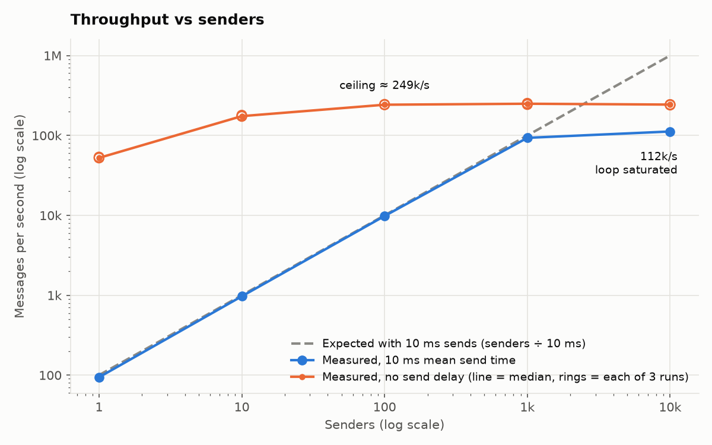
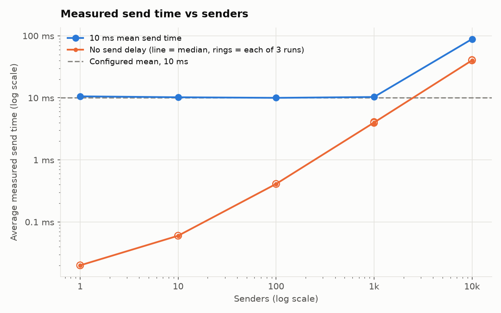
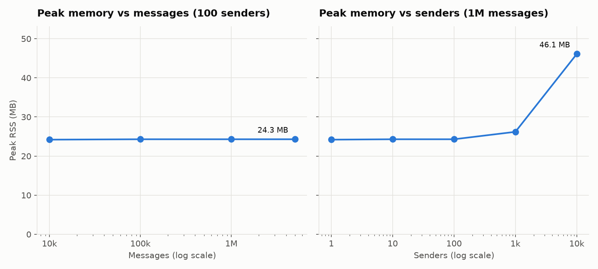

# Performance

How fast the simulation runs, where the limit is, and what it costs in memory.

## Method

```bash
performance/bench.sh > performance/results/m2.txt     # about 6 minutes; SECTIONS=E runs one section
uv run --group bench performance/plot.py              # charts in performance/plots/ from that file
```

`bench.sh` runs the CLI with `--seed 1` and a monitor interval longer than any run, so progress printing is not part of the measurement. Throughput is the `rate` from the final line (attempts per second). Peak memory (RSS) comes from `/usr/bin/time`. Raw output: [`results/m2.txt`](results/m2.txt).

Machine: Apple M2 (8 cores, 8 GB), macOS 26.3.1, Python 3.13.16.

## Results

### A. Throughput vs senders (mean send time 10 ms)

With the send delay dominating, throughput should be `senders / mean send time`.

| Senders | Expected | Measured | Measured avg send time | Peak RSS |
| ---: | ---: | ---: | ---: | ---: |
| 1 | 100/s | 94/s | 10.58 ms | 24.3 MB |
| 10 | 1,000/s | 971/s | 10.22 ms | 24.2 MB |
| 100 | 10,000/s | 9,813/s | 10.00 ms | 24.3 MB |
| 1,000 | 100,000/s | 93,343/s | 10.32 ms | 26.6 MB |
| 10,000 | 1,000,000/s | 112,076/s | 88.55 ms | 50.1 MB |



Up to 1,000 senders throughput tracks the expected line. The gap at 1 sender is sampling: the 200 random delays averaged 10.58 ms, and 1 / 10.58 ms = 94/s. At 10,000 senders the event loop is saturated: throughput stops at ~112k/s and the measured send time jumps from 10 ms to 89 ms, because each sender waits for its turn on the loop after its delay ends.

### B. Overhead ceiling (no send delay, 1M messages, median of 3)

With `--mean-send-time 0` a send does no work beyond one `await asyncio.sleep(0)`, so this measures the simulation's own cost per message.

| Senders | Throughput | Measured avg send time | Peak RSS |
| ---: | ---: | ---: | ---: |
| 1 | 52,394/s | 0.02 ms | 24.2 MB |
| 10 | 174,420/s | 0.06 ms | 24.3 MB |
| 100 | 242,376/s | 0.41 ms | 24.3 MB |
| 1,000 | 249,351/s | 4.00 ms | 26.2 MB |
| 10,000 | 243,363/s | 40.23 ms | 46.1 MB |

The three runs of each row are within 3% of each other.

The throughput chart above shows these rows in orange. The send time chart shows what the extra senders cost:



### C. Memory vs messages (no send delay, 100 senders)

| Messages | Peak RSS |
| ---: | ---: |
| 10,000 | 24.2 MB |
| 100,000 | 24.3 MB |
| 1,000,000 | 24.3 MB |
| 5,000,000 | 24.3 MB |



### D. Where the time goes

`cProfile` at the ceiling (1,000 senders, 1M messages, 23.7 s under the profiler), split so no time is counted twice:

| Part | Time | Share |
| --- | ---: | ---: |
| `generate_message` (of which `random.choices` 12.6 s) | 14.8 s | 62% |
| `queue.put` + `queue.get` | 3.4 s | 14% |
| `sender` loop excluding `get` (send, timing, `task_done`) | 2.9 s | 12% |
| of which `Stats.record` | 0.1 s | 0.5% |
| Event loop scheduling and the rest | 2.6 s | 11% |

The profiler slows code made of many small calls more than other code, so I checked the share without it: generating 1M messages alone takes 2.45 s, against 4.0 s for the whole run. Both measurements put message generation at about 60% of the total.

### E. Queue size (100 senders, one run each)

The default queue holds 2 × senders, here 200. I tried sizes from 1 to 10,000, with realistic 10 ms sends and with no send delay at all.

| Queue size | × senders | 10 ms sends, 20k messages | No send delay, 1M messages |
| ---: | ---: | ---: | ---: |
| 1 | 0.01 | 9,688/s | 47,538/s |
| 10 | 0.1 | 9,738/s | 137,070/s |
| 50 | 0.5 | 9,742/s | 183,413/s |
| 100 | 1 | 9,070/s | 232,225/s |
| **200 (default)** | **2** | **9,654/s** | **222,937/s** |
| 1,000 | 10 | 9,725/s | 233,068/s |
| 10,000 | 100 | 9,487/s | 239,807/s |

Peak memory stayed between 23.7 and 25.4 MB in every run. Each row is a single run, so differences of a few percent are noise (in B, repeated runs varied by up to 3%). The 9,070/s at size 100 is one of those: its random delays happened to average 10.76 ms instead of 10.

## Findings

1. **The bottleneck is one CPU core, and most of that core generates random strings.** At ~245k messages/s the event loop thread is fully busy, and about 60% of its time goes to building the random messages. The queue, the senders and the stats together are the other 40%. Making generation free would raise the ceiling to at most ~400k/s (1M messages / 1.6 s), so the next real step past that is more processes, not faster code.

2. **Senders scale linearly while the send delay dominates.** Each sender adds `1 / mean send time` messages per second until the loop is saturated: up to 1,000 senders at 10 ms here.

3. **Past saturation, more senders only add latency.** In B, throughput is flat from 100 to 10,000 senders while the measured send time grows 100× (0.41 ms to 40 ms). A finished send has to wait for its turn behind every other ready sender. This is why the send time is measured with a clock rather than taken from the random delay: it shows what a user of the system would see.

4. **Real delays cost more than no delay.** With 10 ms delays the loop saturates at ~112k/s, below the 245k/s of the zero-delay case. My understanding, not measured separately, is that each real sleep schedules a timer, which costs more per message than `sleep(0)`'s plain yield.

5. **One sender is limited by hand-offs.** With one sender every message is a switch from the producer to the sender and back, so it reaches only 52k/s. Ten senders already reach 70% of the ceiling.

6. **Memory does not grow with the number of messages.** Peak RSS is 24.3 MB from 10k to 5M messages, because the bounded queue keeps the producer at most `2 × senders` messages ahead. Each sender task costs about 2 KB: 10,000 senders add ~22 MB.

7. **Queue size only matters when sends cost almost nothing, and 2 × senders is enough.** With 10 ms sends, even a one-slot queue keeps 100 senders busy: the producer makes a message in about 2.5 µs, so it always refills the slot long before a sender comes back for more. With no send delay the producer has to keep up with senders that come back immediately, and a small queue makes it stop and hand over the loop after every few messages. Throughput climbs from 48k/s at size 1 to about 230k/s at one slot per sender, then stays flat. The default of two slots per sender sits on that plateau. A bigger queue gains nothing, and a graceful stop drops everything still queued, so I kept 2 ×.

## What I would do next

Not done here, listed in the order I would try them:

- **More processes.** Split the messages across K processes, each with its own loop, and add up their stats. Expected to scale with cores because the counters are independent.
- **Cheaper message generation**, e.g. one `rng.randbytes()` call per message mapped onto the character set instead of one random draw per character. This only raises the ceiling within one process (finding 1).
- **Track loop lag directly** (the time between when a task was ready and when it ran) as a metric, since finding 3 shows it is the first thing to degrade.
